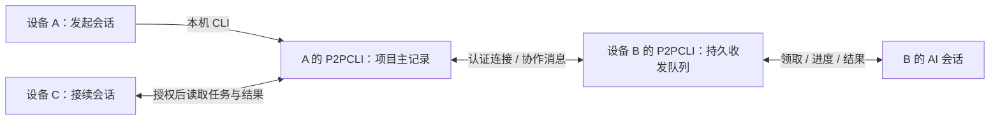

# 跨设备、跨会话协作设计

状态：核心实现已落地，处于实验性手动闭环阶段；跨平台实机、真实 AI 和发布验收仍未完成。

日期：2026-10-27。

适用场景：用户自己的多台电脑，以及这些电脑上经用户授权参与协作的 AI 会话。

本文保留最初的设计语义，同时把当前实现与验收条件分开说明。标为“当前实现”的内容来自现有代码和测试；标为“待验收”的内容是目标或验证清单，不能据此推断已经通过真实设备或真实 AI 验收。可运行的 CLI 手动流程见 [协作手动闭环](collaboration-manual.md)。

当前状态摘要：

| 范围 | 当前状态 |
| --- | --- |
| 协作模型、权限、版本、幂等和任务状态机 | 已实现 SQLite 存储与单元/存储测试；异常组合仍按第 15 节验收 |
| 已认证网络协作请求 | 已实现 `collaboration_v1` 能力协商、`CollabRequest/CollabReply` 和本机/远端路由；旧能力组合只保留原消息 |
| 本机 CLI 手动任务闭环 | 已实现项目、成员、会话、任务、消息、事件、产物和重试命令；两设备手动操作流程可按使用文档执行 |
| 收件箱、发件队列和重启恢复 | 已实现本地私有记录、有限自动重试和 generation 停止；不是一个与 SQLite 共事务的单一队列 |
| 桌面协作入口 | 代码已接入项目、任务、会话、成员、投递和产物视图；本轮未完成发布级 UI 验收 |
| managed worker | 已有 worker 入口及 mock 子进程/JSON 测试；未完成真实 AI 长任务、权限交互和重启后的真实端到端验收 |
| 物理两设备、跨平台和中继验收 | 待验收；现有协作集成测试主要是同进程中的独立节点和模拟链路 |

## 1. 要实现的体验

用户在设备 A 的 AI 会话中提出任务，把其中一部分交给设备 B 的 AI 会话。B 接受任务，在自己的环境中执行，把结果、日志或代码改动交回。用户关闭原会话后，另一个获授权的会话可以读取任务记录并接着推进。

例如：

1. A 上的会话提出“请在 Windows 上验证这次文件传输改动”。
2. A 明确指定代码版本、测试范围、验收条件，把任务分配给 B 上登记的协作会话。
3. B 上的 AI 领取任务，报告执行中的状态；遇到权限确认时标记需要用户处理。
4. B 上传测试日志和结果，A 收到通知并验收。
5. A 原来的会话结束后，新会话读取任务摘要、结果和待办，继续修复或关闭任务。

“跨会话”包括同一设备上的不同会话，也包括不同设备上的会话。共享的是明确发布的任务上下文、消息和产物；不要求迁移 AI 的内部上下文或整个运行中进程。

## 2. 当前基础与限制

| 现有能力 | 代码位置 | 对协作的作用和限制 |
| --- | --- | --- |
| 设备身份、发现、连接和认证连接复用 | `crates/core/src/node.rs`、`identity.rs`、`host.rs` | 可以定位并连接另一台设备；协作服务另行检查项目成员和会话凭据，不把设备信任当成项目授权 |
| 终端创建、恢复和结束 | `crates/core/src/sessions.rs`、`client.rs` | 可以保留后台终端，但会话按连接方公钥隔离 |
| 设备在线状态、会话状态探测 | `crates/core/src/presence.rs` | 可辅助显示可用性；缓存状态不能证明 AI 已接任务 |
| 文件传输、校验和断点续传 | `crates/core/src/files.rs`、`files/lanes.rs` | 可传日志和产物；协作层已有产物声明、接收记录和本机校验入口，但传输与数据库仍是两个可恢复步骤 |
| 一次性远程命令 | `crates/core/src/exec.rs`、`control.rs` | 可辅助准备环境；调用方断开会取消命令，不适合直接作为持久任务执行器 |
| AI 类型、忙闲和确认框识别 | `crates/core/src/agents.rs`、`approval.rs` | 可辅助界面提醒，不能据此认定业务任务成功 |
| 协作存储、消息和任务接口 | `crates/core/src/collaboration/`、`crates/core/src/control.rs` | 已有 SQLite 协调记录、幂等请求、收件箱和本地发件记录；队列容量和权限拒绝会显式返回错误 |
| 协作 CLI 和技能说明 | `crates/cli/src/main.rs`、`crates/cli/src/collab.rs`、`app/src-tauri/src/p2pcli-skill.md` | 已有项目、成员、会话、任务、消息、事件、产物、重试和 worker 命令；手动领取仍需要会话主动查询 |

当前网络协议在保留终端、远程执行和文件操作的基础上，已增加可选的协作能力，见 `crates/core/src/proto.rs`、`client.rs` 和 `host.rs`。本机控制口也已提供协作请求入口。

特别注意：`SessionManager::list(owner)` 按 `p2pcli-{owner}-` 前缀筛选，`attach(owner, id)` 也绑定 owner。A 在 B 上创建的终端，不会自动出现在 C 连接 B 后的会话列表中。第一版不删除这一隔离规则。

## 3. 第一版边界

以下是第一版的验收目标，代码存在不等于这些场景均已验收：

- 两台设备、两个明确登记的 AI 会话，完成一次任务创建、分配、领取、回报和验收。
- 同机不同会话走相同的协作接口。
- 消息和任务持久化，断线后补收，重复请求不创建重复任务。
- 任务不依赖发起会话存活；新会话经授权可以接续。
- 文件或代码补丁作为任务产物交付。
- 用户能够看到未领取、运行、待确认、断线、结果待验收等状态。

第一版不包含：

- 任意 AI 产品内部聊天历史的完整同步、运行中进程跨机器迁移。
- 多个客户端无控制地同时向同一个终端输入。
- 自动把目录双向同步成同一份工作区。
- 协调设备自动选主、故障时自动把运行任务交给另一台设备重跑。
- 默认开放全部后台终端，或者自动允许 AI 的权限确认。

推进顺序为“可靠的任务与消息闭环 → 已有会话按需领取 → 至少一种经过验证的自动接入适配器”。只有最后一步通过真实 AI 的端到端验收，才可以对外称为自动跨会话协作。

## 4. 总体结构

每个协作项目指定一台协调设备，保存任务和项目事件的主记录。其他设备维护本地收件箱、发件队列和执行记录。

协调设备可以同时运行 AI，也可以只负责记录和路由。它是用户的一台普通 P2PCLI 设备，不需要把任务内容交给牵线服务器。



职责：

| 层 | 职责 |
| --- | --- |
| 现有网络层 | 设备身份、加密连接、直连和中继 |
| 协作服务 | 项目成员、会话登记、消息路由、任务状态、事件补收 |
| 本地执行接入 | 将任务交给 AI，收集明确的进度和结果 |
| CLI / 桌面界面 | 人和 AI 使用相同的任务语义 |

协调设备离线时，已确认领取的任务可以继续执行，本地积累进度和结果；新领取、转交和验收需要等协调设备恢复。第一版不提供协调设备故障切换；协调数据库永久丢失需要人工恢复，不能仅凭某台设备的局部缓存宣布恢复全部项目状态。

## 5. 身份、登记和访问范围

### 5.1 三种标识分开

| 标识 | 含义 |
| --- | --- |
| `device_id` | 现有设备公钥，作为网络身份 |
| `terminal_ref` | 可选的 `{ host_device_id, owner_device_id, terminal_id }`，定位现有终端 |
| `agent_session_id` | 协作会话 ID；当前由协调存储在登记时生成，新会话显式登记，不自动继承运行中的 attempt |

协作会话地址使用 `(device_id, agent_session_id)`。设备名、会话备注只用于显示和搜索，不作为持久身份。

`terminal_ref` 必须带 owner，因为现有终端操作依赖 owner。不同 AI 在同一个终端里先后启动，也应有不同的协作会话 ID，不能把旧任务自动交给新进程。

### 5.2 会话登记

设计上的会话目录包括以下信息；当前 `AgentSession` 已存设备、项目、名称、模式、可选终端/目录、可用标记和心跳时间，AI 类型、任务类型和完整能力矩阵仍属扩展目标：

- 宿主设备、协作会话 ID、可选终端引用、显示名称、AI 类型。
- 项目、允许的任务类型、本机工作目录映射。
- 接入模式：`manual_pull` 或 `managed_adapter`。
- 可用状态、最近心跳、当前运行任务。
- 接入能力，例如能否自动投递、取消、获取结构化结果。

只展示加入该项目并允许公开的协作会话。登记的进程退出后标记不可用，保留历史引用。心跳和终端画面识别是辅助信号，不能用来自动完成任务。

### 5.3 授权

协作操作必须同时满足设备连接认证、项目成员资格和操作权限。受信设备不因此自动加入所有协作项目。

第一版成员角色：

- `admin`：管理项目和成员，明确执行转交。
- `dispatcher`：创建、分配和验收任务。
- `worker`：读取分配给本设备的任务，由本机获授权会话领取和回报。
- `viewer`：读取项目允许公开的记录。

成员资格不传递：A 信任 B、B 信任 C，不代表 C 能访问 A 的项目。

会话加入项目时由协调存储生成不公开的登记凭据，CLI 保存到本机受限凭据文件，后续请求携带会话身份。网络发送方设备身份从认证连接中取得，不信任 JSON 自报的 `device_id`；协调存储同时验证设备、成员和会话凭据。

这些凭据用于避免误路由，不构成同一操作系统用户下的恶意进程隔离；现有终端和 `exec` 本就提供该用户级执行能力。第一版的信任边界是授权设备和操作系统用户。

撤销成员后停止后续投递、订阅和写入，并在请求时检查权限，不能只在建立连接时检查一次。已经交付到离线设备的数据无法远程收回，已经启动的进程也不能保证立即停止；界面要显示撤销和停止请求的实际确认情况。

## 6. 数据模型与持久化

当前实现使用本地 `collaboration.sqlite`，由 `rusqlite` 的 bundled SQLite 驱动打开；数据库事务保存项目、成员、会话、任务变化、事件、幂等响应和协作消息。数据库 schema 当前为版本 1，打开失败会阻止节点初始化，不会静默丢弃协作数据。不改写现有信任和连接历史 JSON。

新增结构放在 `crates/core/src/collaboration/`，先按协议、存储、服务和接入职责拆分。

下表保留设计实体；具体序列化字段以 `model.rs` 为准，并非表内每个扩展字段都已经实现。

| 实体 | 核心字段 |
| --- | --- |
| `Project` | ID、名称、协调设备 ID、协议版本 |
| `Member` | 项目 ID、设备 ID、角色、授权版本、撤销时间 |
| `AgentSession` | 宿主设备、会话 ID、终端引用、接入模式、能力、状态 |
| `Task` | ID、项目、发起会话、标题、目标、验收条件、输入、目标会话、状态、版本 |
| `Attempt` | ID、任务、执行设备和会话、开始时间、最后心跳、执行状态、取消确认 |
| `Message` | ID、项目、任务、来源、目的、类型、内容、交付和消费状态 |
| `Event` | 项目、单调递增序号、类型、实体 ID、载荷 |
| `Outbox` | 操作 ID、目标设备、请求载荷、重试次数、下一次尝试时间 |
| `Receipt` | 对端、操作 ID、原始请求摘要、已提交响应 |
| `Artifact` | 任务、attempt、提供设备、文件名、大小、内容哈希、接收位置、传输状态 |

`Task` 必须记录代码输入的仓库标识和基线 commit，或者文件输入的内容哈希。路径是某台机器上的位置，不是跨设备的文件身份。

当前 `TaskSpec.inputs` 是自由 JSON，存储层没有强制要求仓库或基线字段。填齐交接信息、检查基线和建立独立工作目录仍由调用方负责。

协调设备在同一个事务里检查任务版本、更新状态、追加事件并记录幂等响应。接收端在消息快照落盘后才返回交付确认。数据库写失败时不返回成功。

本地队列也持久化操作 ID，重试和重启都沿用原 ID。已经收到确认的幂等记录第一版不自动清理；以后增加清理时，必须配套重放期限和过期请求拒绝规则。

当前交付实现补充：

- `collaboration-outbox/` 和 `collaboration-inboxes/` 是数据目录下的私有 JSON 记录，用于在网络请求之外保留待发请求和收件快照；它们与 SQLite 不是一个跨文件事务。
- `TaskCreate` 和 `MessageSend` 可以由后台 worker 自动重试；领取、进度、结果、停止和消费等带执行副作用的操作需要调用方明确重试。
- 收件快照和成功的 `MessageDelivered` 请求使用稳定 ID；重启后由 delivery worker 按记录继续同步。`delivery_epoch` 用于停止旧的后台实例，不能把它理解成跨设备的全局队列代次。
- 本地返回 `queued` 只表示请求已落盘；`committed_unverified` 只表示本机保存过一次提交结果但尚未重新核对远端权限和状态。二者都不能直接当成任务完成。

## 7. 任务生命周期

任务业务状态与网络状态分开。`offline`、`stale`、`syncing` 是连接或信息新鲜度状态，不覆盖任务状态。

| 状态 | 含义 | 允许的下一步 |
| --- | --- | --- |
| `queued` | 已由协调设备持久化，尚未接受领取 | 领取、取消、调整分配 |
| `running` | 指定会话已成功领取某次 attempt | 报进度、阻塞、提交结果、请求取消 |
| `blocked` | 当前 attempt 仍归原会话，等待权限、输入或环境修复 | 继续执行、提交结果、请求取消 |
| `result_ready` | 成功执行的结果已持久化，等待发起方验收 | 验收、要求返工 |
| `completed` | 有权限的验收方确认满足条件 | 保留为历史 |
| `failed` | 执行方明确报告本次执行失败 | 人工决定是否创建新 attempt |
| `cancel_requested` | 已请求停止，尚未确认 | 等待执行方确认停止或报告已完成 |
| `cancelled` | 未开始的任务被取消，或执行停止已确认 | 保留为历史 |

状态转换由协调设备检查角色、当前版本和 attempt。所有修改带 `expected_version`；冲突返回当前版本，调用方刷新后再决定，不静默覆盖。

### 7.1 领取与并发

领取请求带任务 ID、目标会话和操作 ID。协调设备只允许被分配的会话领取；原子地从 `queued` 转为 `running`，生成 attempt ID，再返回领取确认。

执行方只有收到确认或查询到自己的领取已经提交，才能开始任务。若确认丢失，用同一操作 ID 重试，取回同一 attempt。两个会话同时争抢时至多一个得到有效领取。

心跳失联仅表示执行状态不确定。**不能因为超时就自动重跑任务**，否则断网期间可能出现两个会话同时修改代码或执行外部操作。

转交运行任务需要旧 attempt 明确停止；旧设备不可达时标记“执行状态未知”，等待人工核实，不提供自动强制重跑。旧 attempt 结束后，任务才能重新排队并分配。

### 7.2 取消和完成竞争

尚未领取可直接取消。已经运行则先写入 `cancel_requested`，执行端尽力停止，并回报实际情况。

如果取消请求到达时任务已经结束，保存“停止前已完成”的结果供用户检查，不声称操作已经回滚。结果、停止确认和版本冲突按协调设备提交顺序处理，保留事件记录。

提交结果必须关联有效 attempt；旧 attempt 的迟到结果只作为历史事件，不覆盖新 attempt。

### 7.3 AI 完成与用户验收

AI 显示空闲、终端退出、远程命令退出码为 0，都不能单独令业务任务变成 `completed`。

执行结果至少包含摘要、完成项、未完成项、验证命令和结果、产物引用。执行方明确报告失败时进入 `failed`；成功时进入 `result_ready`，由发起方或获授权的接续会话验收。必需产物尚未接收并校验完成时阻止验收，界面显示仍在同步。

幂等处理保证协议操作不重复创建任务，不保证 AI 操作外部系统“恰好一次”。执行器崩溃且外部动作是否完成不明确时，进入待核实状态，不自动再次执行。

## 8. 消息与网络协议

第一版复用已认证的终端连接，在新双向流上发送协作请求，复用现有 `Node::remote_for` 的连接和选路。暂不新增独立 ALPN，避免第一版重复实现认证和 IPv6 连接路径。

在 `Hello` / `Welcome` 增加可选能力字段，例如 `collaboration_v1`。缺失表示不支持；没有协商成功就不发送新增消息。现有 `PROTO_VERSION = 2` 的严格检查保留，增加兼容测试证明旧消息仍能正常解析。

当前已实现 `Msg::CollabRequest` 和 `Msg::CollabReply`，载荷由协作模块定义。`Hello` / `Welcome` 只在对端声明能力时携带 `collaboration_v1`；`PROTO_VERSION = 2` 的严格检查仍保留。未协商该能力时，客户端不会发送协作流，宿主端也会拒绝收到的新协作消息。

当前支持的操作包括：

| 操作 | 行为 |
| --- | --- |
| `ProjectCreate` / `ProjectsList` / `ProjectGet` / `MembersList` / `MemberSet` | 创建和读取项目、管理成员 |
| `SessionRegister` / `SessionsList` / `SessionHeartbeat` | 登记和查询可访问的协作会话、更新可用标记 |
| `MessageSend` / `Inbox` / `MessageDelivered` / `MessageConsume` | 发送、拉取、确认落盘和确认指定会话已消费 |
| `TaskCreate` / `TaskAssign` / `TaskGet` / `TasksList` | 创建、分配、查询任务 |
| `TaskClaim` / `TaskProgress` / `TaskResult` | 领取和回报 |
| `TaskCancel` / `TaskStopAck` / `TaskAccept` / `TaskRequeue` | 取消、停止确认、验收、明确返工 |
| `EventsRead` | 按游标读取有权访问的后续事件；当前是立即分页查询，不是服务端长轮询 |
| `ArtifactDeclare` / `ArtifactReceipt` | 关联产物、记录接收确认 |

当前 `Request` 包含 `request_id`、可选 `project_id`、可选会话 `auth` 和 `action`。协议版本由握手和能力协商约束；需要并发保护的修改在 action 中携带 `expected_version`，执行回报还带 attempt ID。

服务端用 `(认证来源设备, 操作 ID)` 去重。同一 ID 携带不同请求内容时报 `idempotency_conflict`。业务拒绝返回结构化错误码，例如 `forbidden`、`version_conflict`、`session_unavailable`、`unsupported_capability`。

协调设备转交消息时，外层连接身份是协调设备，内层来源是它已校验并记录的原始设备和会话。接收方只接受本项目指定协调设备的转交，不把任意对端自报的消息来源当成可信身份。

消息交付状态必须区分：

1. `queued_local`：仅发起设备落盘。
2. `accepted`：协调设备已接收并记录。
3. `delivered`：目标设备收件箱已落盘。
4. `consumed`：指定会话通过接入接口确认读取。
5. 业务任务的 `running` / `result_ready`：由任务协议单独报告。

`MessageConsume` 不等于 `TaskClaim`，普通消息送达也不会自动执行其中的命令。

设备主动向协调设备拉取事件和投递内容，再回报接收结果；因此协调设备无需反向获得执行设备的终端权限。第一版只支持项目内经协调设备路由的协作消息，不要求成员设备互相直连。

事件使用协调设备按项目分配的序号排序，不依赖设备时钟。客户端在处理完成后保存游标，断线从最后持久游标继续。读取时逐条做权限过滤，并返回服务端扫描游标，避免不可见事件使客户端卡住。

协作请求复用认证后的终端连接，但客户端使用独立的协作请求预算；当前 `EventsRead` 不等待新事件，而是返回已存在的分页结果和服务端游标。每批最多 100 条，协作请求限制在 64 KiB；大内容走文件传输。

网络错误按退避重试，拒绝授权和版本不兼容不循环重试。当前本地发件记录最多 10,000 条、总大小约 100 MiB，达到上限时明确拒绝新增，不能静默丢消息。

取消本地任务时，只有能够确认从未发送的操作，才可原子地撤出待发队列并记录本地取消。已经发送但确认丢失的请求必须先按原操作 ID 查询或重试，确认是否提交，再执行正式取消；离线时显示取消待同步，不能声称远端已停止。

## 9. AI 如何真正接手任务

这是实现的关键，必须避免把技能安装或终端状态识别当成自动接入能力。

### 9.1 第一阶段：已有会话主动领取

用户把现有 AI 会话登记为 `manual_pull`。技能说明教它查询收件箱、领取指定任务、报告结果。

优点是可以先打通可靠的协作语义，不依赖每家 AI 的内部接口。但技能文件不能保证空闲中的 AI 自动醒来，因此此阶段允许用户提示会话“检查协作任务”，界面必须显示“待会话领取”。

会话只有在用户授权的任务范围内才能继续向其他会话委派；收到协作消息本身不扩大其执行权限。

### 9.2 当前的受管理接入适配器状态

当前已有 `p2pcli collab worker --config <JSON>` 入口，并支持登记为 `managed_adapter`。worker 会在本地领取任务、保存 attempt 和结果记录，并通过结构化 JSON 结果提交回协作服务；网络断开时由协作请求的持久记录决定是否可重试。

目前只能确认以下范围：

1. worker 的子进程输入、官方 JSON 形状、非零退出和结果解析有 mock 子进程测试。
2. worker 重启时已开始的 attempt 会进入需要人工核实的状态，不会凭猜测自动再执行一次。
3. 当前没有真实 AI 长任务、真实权限确认、真实 AI 版本兼容、物理两设备 worker 或断电恢复的验收证据。

因此 worker 仍是实验性接入。它不能让文档声称“任意 AI 均可可靠后台注入”，也不能把 mock/JSON 测试当作真实 AI 端到端闭环。使用参数和配置示例见 [协作手动闭环](collaboration-manual.md)。

适配器能力矩阵仍至少包括：启动、输入投递、结构化输出、权限等待、取消、进程退出、重启恢复。缺少某项能力时，明确降级为手动操作。

### 9.3 向已有交互终端投递

如果后续支持向已经打开的 AI 终端自动发送文本，应单独实现并验收：

- 校验当前 AI 进程、会话代次、确认状态和允许输入的状态。
- 串行化人工输入与自动输入，使用整段粘贴，避免长文本被拆成多条命令。
- AI 忙碌或等待权限确认时排队；无法识别时交给用户。
- 崩溃发生在输入发送与记录确认之间时，不能盲目再次注入。

终端画面输入很难提供可靠的任务接收确认，第一版不把它作为唯一交付途径。即使文本已发送，仍要收到 AI 的领取或消费确认。

## 10. 上下文、代码和产物交接

每个任务的交接包应包含：

- 目标、任务范围、验收条件和用户限制。
- 已做的操作、关键决策、当前问题、下一步。
- 仓库与基线 commit，或输入文件及其哈希。
- 相关消息和产物引用。
- 不确定性、失败尝试和需要用户处理的事项。

任务摘要由参与会话主动提交，并保留版本和来源；不得把自动生成的摘要当成未经核实的事实。原始日志作为产物保留，便于接续会话核查。

代码协作流程：

1. 发起方指定基线 commit，并明确是否包含未提交改动。
2. 执行设备验证基线，使用独立 checkout 或 worktree；已有未提交改动不自动覆盖。
3. 每个任务使用独立分支或工作目录，避免并行任务写同一目录。
4. 交付 commit、patch 或 Git bundle，以及验证报告。
5. 接收方检查基线、冲突和测试，再决定合并；传输成功不等于合并成功。

文件产物复用现有传输能力。协调设备存元数据，第一版要求执行设备先把需要交付的产物传到协调设备，校验完成并登记接收位置后，才将其标为可供验收；后续接续设备从协调设备获取。

协议中使用产物 ID、大小和哈希。`C:\work\result.log` 或 `/Users/.../result.log` 只属于提供设备，不能直接解释成本机路径。文件传输完成与数据库关联不是一个事务，应通过持久化的传输关联记录在重启后核对、补登记；未完整收到的产物显示 `pending`，不冒充可下载结果。

## 11. 当前 CLI

以下命令与当前 Clap 定义一致；引号中的大写标记需替换为实际值。CLI 连接本机正在运行的桌面服务，不会自行启动节点。`--coordinator` 默认本机，`--project` 明确项目，`--session-file` 指向本机私有会话凭据。完整双设备操作顺序、输入文件和重试方法见 [协作手动闭环](collaboration-manual.md)。

```sh
# 创建项目；成员授权由项目管理员在界面或成员命令中配置
p2pcli collab project create --name "P2PCLI 验证"
p2pcli --json collab --project "PROJECT_ID" member set "B_DEVICE_ID" --role worker

# 本机登记会话并查看项目内可协作的会话
p2pcli --json collab --coordinator "A_DEVICE_ID" --project "PROJECT_ID" --session-file ./b-session.json session register --name "Windows 验证" --mode manual-pull
p2pcli --json collab --project "PROJECT_ID" session list

# A 创建任务；task.json 含目标会话、目标、基线和验收条件
p2pcli --json collab --project "PROJECT_ID" task create --file task.json

# 执行会话查询收件箱，明确领取
p2pcli --json collab --coordinator "A_DEVICE_ID" --project "PROJECT_ID" --session-file ./b-session.json inbox
p2pcli --json collab --coordinator "A_DEVICE_ID" --project "PROJECT_ID" --session-file ./b-session.json task claim "TASK_ID"

# 回报进度与结果，必须带领取得到的 attempt
p2pcli --json collab --coordinator "A_DEVICE_ID" --project "PROJECT_ID" --session-file ./b-session.json task progress "TASK_ID" --attempt "ATTEMPT_ID" --file progress.txt
p2pcli --json collab --coordinator "A_DEVICE_ID" --project "PROJECT_ID" --session-file ./b-session.json task result "TASK_ID" --attempt "ATTEMPT_ID" --file result.json

# 发起方或接续会话检查、等待和验收
p2pcli --json collab --project "PROJECT_ID" task show "TASK_ID"
p2pcli --json collab --project "PROJECT_ID" task wait "TASK_ID" --timeout 60
p2pcli --json collab --project "PROJECT_ID" task accept "TASK_ID"
```

当前没有 `project join` 或 `collab sessions` 命令：成员由管理员执行 `member set` 授权，会话查询为 `session list`。`inbox` 查询的是消息；发现待领取任务使用 `task list` / `task show`。登记凭据保存在本机私有文件，JSON 输出只返回会话和凭据文件位置，不打印 token。

CLI 每次写操作生成并在发送前持久化操作 ID 和完整请求；可显式指定 `--request-id`。响应不确定时，优先用输出的原始 `request_file` 执行 `request --file`，保持协调设备作用域一致。未显式给版本的修改先读取一次最新版本并做条件提交，冲突仍返回错误，不能自动覆盖。

`task wait` 超时只结束等待，不取消任务。协作普通请求的退出码为 0 无错误响应、1 业务或运行错误、2 Clap 参数错误、3 不支持能力；等待超时为 4。退出码 0 也可能是仅本地排队、提交状态待核实，或等到了 `failed` / `cancelled`，必须检查 JSON 的 `delivery`、`error` 和任务状态。

新增独立的 `collab inbox`，不混用当前文件传输的 `p2pcli inbox`。

## 12. 桌面界面

当前已接入协作页面和 Tauri 命令。下列内容保留为界面设计与验收要求，不能把组件存在等同于通知、角色控制及异常状态均已完成实机验证。

保留现有设备和终端导航，增加“协作”入口，按项目展示：

- 任务列表：负责人、执行设备和会话、业务状态、同步状态、最近更新。
- 任务详情：目标、输入版本、消息、进度、产物、执行历史和验收结果。
- 会话目录：用户登记的参与会话、接入模式、能力和当前可用性。
- 成员管理：可访问设备、角色、撤销入口。

操作包括创建、分配、发送补充信息、查看结果、验收、取消、接续。按钮根据角色、状态和版本限制显示。

通知只在任务待用户处理、结果可验收、明确失败等有意义的变化出现。设备离线和缓存状态明确标识；不能把最后一次“运行中”当成实时进度。

第一版的“接续”是把任务的协调或执行责任交给新的授权会话，不等同于打开原终端。以后如果需要共享原终端，单独增加该终端的访问授权和输入控制权，不直接扩大 `SessionManager::list` 的范围。

## 13. 代码改造位置

| 位置 | 改动 |
| --- | --- |
| `crates/core/src/collaboration/`，新增 | 数据模型、事务存储、权限检查、幂等处理、事件读取和收发队列 |
| `crates/core/src/proto.rs` | 可选能力字段与协作请求、响应外层消息 |
| `crates/core/src/host.rs` | 认证后的协作消息分发，逐请求校验项目权限 |
| `crates/core/src/client.rs` | 协作请求、能力检查和独立超时预算 |
| `crates/core/src/node.rs` | 持有协作服务，连接复用、队列恢复和后台同步生命周期 |
| `crates/core/src/control.rs` | 增加本机协作命令，验证本地会话登记 |
| `crates/cli/src/main.rs`、`collab.rs`、`worker.rs` | `collab` 命令组、私有凭据与重试文件、实验性前台 worker |
| `crates/core/src/sessions.rs` | 继续沿用原 owner 隔离，不因协作扩大终端权限 |
| `crates/core/src/files.rs` | 复用文件传输；当前通过协作 `ArtifactDeclare` / `ArtifactReceipt` 显式关联和校验 |
| `app/src-tauri/src/lib.rs`、`app/src/api.ts` | 桌面命令和类型 |
| `app/src/components/` | 协作任务列表、详情、会话目录和成员管理 |
| `app/src-tauri/src/p2pcli-skill.md` | 新增查询、领取、回报和交接流程，只在能力可用时使用 |

首次接入 AI 的适配器当前位于 CLI 的 `worker.rs`，是单独启动的前台进程，不承诺桌面应用自动在后台启动它。验证一种后再考虑独立 crate 和更多产品。

节点因代理或中继配置更新而替换时，协作存储和执行记录需延续，后台同步任务先停旧实例再起新实例，避免重复拉取、重复执行或数据库并发写入失控。

## 14. 实施阶段与交付条件

下表是原定阶段的交付门槛，不是完成打勾表。当前核心实现和自动化测试覆盖了 M0 至 M2 的部分条件，M3 至 M5 的真实 AI、物理设备和发布验收仍需单独记录。

| 阶段 | 工作 | 完成条件 |
| --- | --- | --- |
| M0：契约 | 固定模型、权限、状态机、错误码和兼容策略，形成协议样例 | 可以用样例说明创建、领取、断线、重试、取消和接续的完整过程 |
| M1：本机闭环 | 数据库、状态机、收发记录、本机 CLI、会话登记 | 两个本机会话完成任务闭环，重启后记录和幂等行为正确 |
| M2：跨设备闭环 | 能力协商、网络消息、事件补收、项目成员和产物 | 两个独立节点完成相同闭环；断网重连无丢任务、无重复领取 |
| M3：已有 AI 接入 | 更新技能说明、手动领取流程和桌面基础界面 | 真实 AI 会话明确领取并回报；换会话后可读取上下文并接续 |
| M4：自动接入 | 查验并实现一种受管理适配器 | 用户发起后目标 AI 无需人工复制任务即可接手、执行、回报；权限等待仍正确交给用户 |
| M5：发布验证 | 异常恢复、平台测试、旧版本互通、界面通知 | macOS 与 Windows 实机验证通过，能力和限制与文档一致 |

M1、M2 可用测试执行器验证协议，但不能用测试执行器代替 M3、M4 的真实 AI 验收。M3 可以发布为显式标注的手动领取试验功能，自动协作宣传以 M4、M5 为门槛。

首个可演示任务建议是：A 指定一个代码 commit，B 在独立目录执行明确的验证任务并回传日志，A 的新会话读取结果并验收。

## 15. 验证清单

以下是待持续执行的验收范围。仓库已有 `store_tests.rs`、delivery/inbox 单元测试和 `crates/core/tests/collaboration.rs` 两节点测试；两节点运行于同一进程，不能替代物理两设备 E2E。`worker_tests.rs` 使用 mock 子进程和 JSON，不构成真实 AI 长任务验证。本文没有宣称完整清单已通过。

### 15.1 单元和存储测试

- 每个合法和非法状态转换、每个角色允许和拒绝的操作。
- 同一操作重试返回原结果；同一 ID 不同内容被拒绝。
- 两个领取请求只能成功一个，迟到结果不能覆盖新的 attempt。
- 数据库提交前后崩溃、重启和迁移失败，不返回虚假成功或丢失已确认记录。
- 队列容量、消息体、帧大小和事件分页上限；未来实现长轮询时另验超时上限。

### 15.2 两节点集成测试

在 `crates/core/tests/` 的协作测试中使用不同数据目录和实际节点代码，并继续覆盖：

- 创建、分配、领取、进度、提交、产物接收、验收的完整链路。
- 收到写请求后丢失响应，再重试；状态和结果只提交一次。
- 接收端落盘后、发送确认前断线；重连补发不重复消费。
- 协调设备和执行设备分别重启，游标、队列和有效 attempt 保留。
- 执行中断网不自动转交；协调设备离线时不能新领取。
- 未授权设备、伪造来源会话、越项目访问、成员撤销后的现存连接请求被拒绝。
- 新旧能力组合不发送未知协作消息，已有终端和文件功能不回归。
- 节点配置重载不产生两个同步器或两个执行实例。

### 15.3 实机和真实 AI 验收

- macOS 与 Windows 两台设备完成任务闭环，分别验证直连和中继场景。
- 执行设备等待权限确认、AI 崩溃、进程正常退出但无结果时均显示正确状态。
- 取消与完成同时发生时保留真实结果，不声称撤销已经发生的文件修改。
- A 的原始会话关闭，A 或 C 的新授权会话可以读取交接包并继续验收。
- 自动适配器重启后，不重复向 AI 投递无法确认是否已消费的输入。
- 代码目录存在未提交改动、基线不符或补丁冲突时明确停止相关步骤。

完成实现后运行相关 Rust 测试、`cargo test --workspace` 和 `pnpm run check`。增加界面后运行前端构建并验证任务列表、详情、异常状态和通知；跨平台实机结果单独记录，不能用单机测试替代。

## 16. 已采用决定与待核验事项

当前实现沿用以下决定：

1. 一个项目一台固定协调设备，第一版没有自动选主。
2. 保留终端 owner 隔离，另建授权的协作会话目录。
3. 事务持久化、至少一次传递与幂等处理，不承诺外部执行恰好一次。
4. 先让已有会话主动领取，再实现一种经过验证的自动适配器。
5. 代码按独立目录和版本交付，产物通过协调设备保存与分发。
6. 失联不触发自动转交；任务完成必须有明确结果与验收。

存储已采用 bundled SQLite 和 schema 版本检查；worker 当前面向 Claude Code 非交互 JSON 接口。实际 AI 版本/参数兼容、权限等待、取消与长任务恢复、Windows 行为和物理两设备 E2E 仍待核验，不据此宣称自动协作已经验收。
